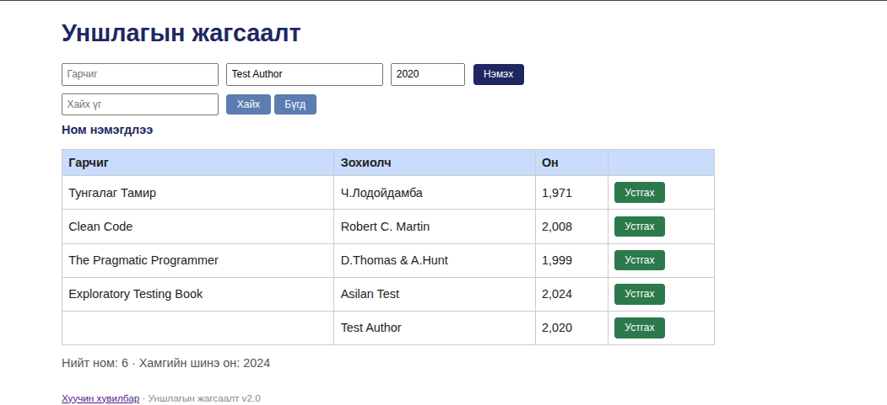

# BUG-05: Номын нэр хоосон байхад ном нэмэгдэж байна

**Огноо:** 2026-11-20
**Аялал:** Couch Potato
**Түвшин:** Major
**Төлөв:** Дахин баталгаажсан

## Урьдчилсан нөхцөл
Reading List App ажиллаж байгаа.

## Алхамууд
1. Ном нэмэх хэсгийг нээх.
2. Номын нэрийг хоосон үлдээх.
3. Зохиогчид `Test Author` оруулах.
4. Онд `2020` оруулах.
5. Нэмэх товч дарах.

## Хүлээгдсэн үр дүн
Ном нэмэгдэхгүй бөгөөд номын нэр заавал шаардлагатай гэсэн алдааны мессеж харагдана.

## Бодит үр дүн
Хоосон нэртэй ном жагсаалтад нэмэгдсэн. API-аар дахин шалгахад хоосон title-тэй POST хүсэлт HTTP 201 Created буцааж, номын жагсаалтад хоосон нэртэй бичлэг нэмсэн.

## Нотолгоо
- Screenshot: 
- `evidence/session-notes.md` — анхны session-ийн тэмдэглэл.
- `evidence/bug-05-empty-title.txt` — API-аар дахин баталгаажуулсан үр дүн.
