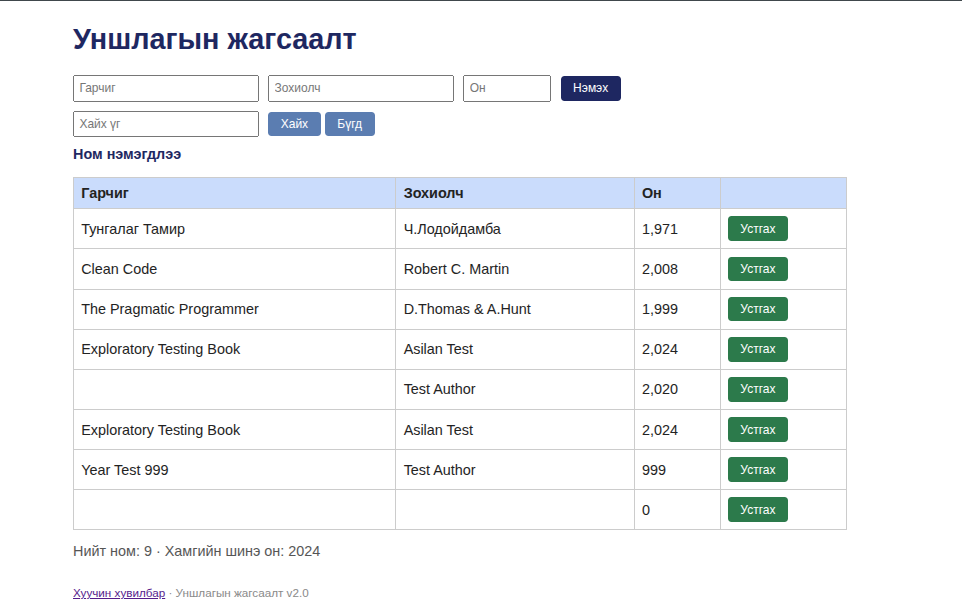

# BUG-06: 1000 оноос өмнөх номын он зөвшөөрөгдөж байна

**Огноо:** 2026-11-20
**Аялал:** Couch Potato
**Түвшин:** Major
**Төлөв:** Дахин баталгаажсан

## Урьдчилсан нөхцөл
Reading List App ажиллаж байгаа. Charter-д номын оны зөвшөөрөгдөх хүрээг 1000–2100 гэж тодорхойлсон.

## Алхамууд
1. Ном нэмэх хэсгийг нээх.
2. Номын нэрд `Year Test 999` гэж оруулах.
3. Зохиогчийн нэрд `Test Author` гэж оруулах.
4. Оны талбарт `999` гэж оруулах.
5. Ном нэмэх үйлдэл хийх.

## Хүлээгдсэн үр дүн
1000–2100 оны хүрээнээс гадуурх утгыг зөвшөөрөхгүй байх.

## Бодит үр дүн
999 онтой ном амжилттай нэмэгдсэн. API-аар дахин шалгахад HTTP 201 Created буцаж, бичлэг жагсаалтад орсон.

## Нотолгоо
- Screenshot: 
- `evidence/session-notes.md` — анхны session-ийн тэмдэглэл.
- `evidence/bug-06-year-boundary.txt` — API-аар дахин баталгаажуулсан үр дүн.
