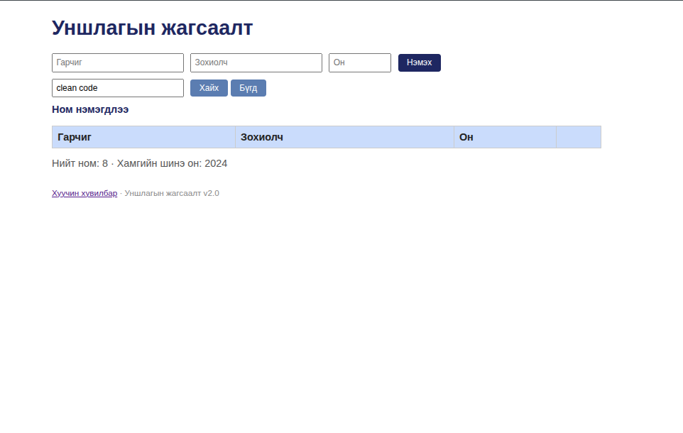

# BUG-07: Номын хайлт том, жижиг үсгийг ялгаж байна

**Огноо:** 2026-11-20
**Аялал:** Supermodel
**Түвшин:** Major
**Төлөв:** Дахин баталгаажсан

## Урьдчилсан нөхцөл
Жагсаалтад `Clean Code` нэртэй ном байна.

## Алхамууд
1. Reading List App-ийг нээх.
2. Хайлтын талбарт `clean code` гэж бичих.
3. Хайлтын үр дүнг шалгах.
4. Хайлтын талбарт `Clean Code` гэж бичиж дахин шалгах.

## Хүлээгдсэн үр дүн
Хайлтын үг том, жижиг үсгийн ялгаанаас үл хамааран `Clean Code` номыг харуулах.

## Бодит үр дүн
`clean code` гэж хайхад ном харагдаагүй. Харин `Clean Code` гэж хайхад ном гарч ирсэн. API-аар дахин шалгахад lowercase хайлт хоосон массив, uppercase хайлт тухайн номыг буцаасан.

## Нотолгоо
- Screenshot: 
- `evidence/session-notes.md` — анхны session-ийн тэмдэглэл.
- `evidence/bug-07-case-search.txt` — API-аар дахин баталгаажуулсан үр дүн.
